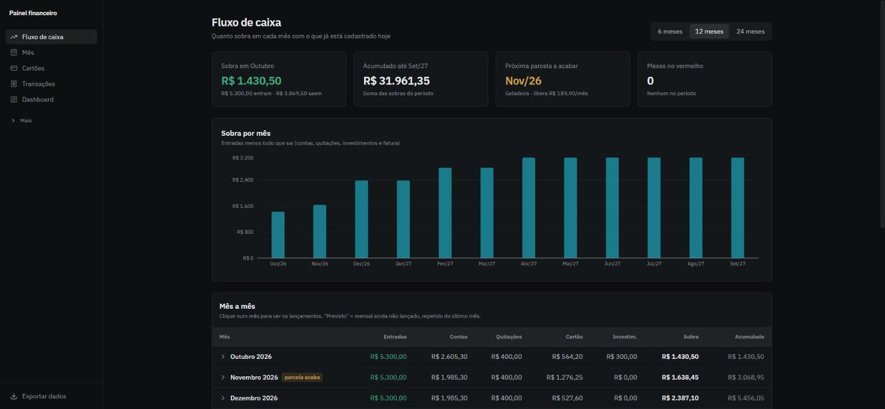
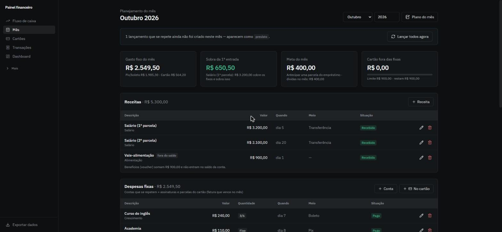
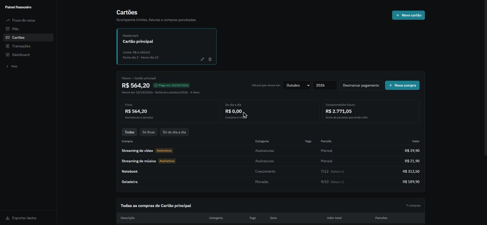
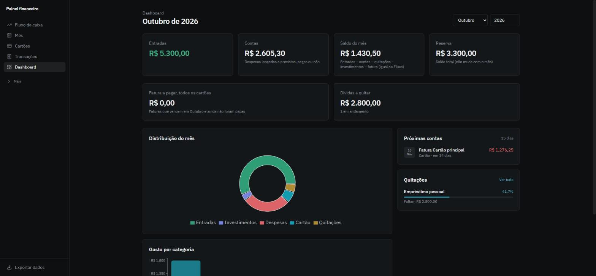

# Painel Financeiro

[](https://github.com/WallaksCardoso/painel-financeiro/actions/workflows/ci.yml)

Painel pessoal de fluxo de caixa: mostra **quanto sobra em cada mês** com o que já está
comprometido hoje (contas fixas, faturas de cartão, parcelas e dívidas) e **quando cada
parcela termina**. Nasceu para substituir uma planilha mensal feita à mão.



| Visão do mês | Cartões |
| --- | --- |
|  |  |



> Os prints usam os dados fictícios do comando de demonstração (veja abaixo).

## O que ele faz

- **Fluxo de caixa** — entradas, contas, quitações, investimentos e fatura mês a mês, com
  sobra, acumulado e o aviso de quando cada parcela acaba.
- **Mês** — receitas, despesas fixas (contas + assinaturas e parcelas do cartão), outras
  saídas, dívidas do mês e um plano com meta, limite do cartão e anotações.
- **Cartões** — fatura calculada pelo dia de fechamento, separação entre fixos e compras do
  dia a dia, compras "em andamento" cadastradas como _parcela 7 de 12_ e marcação de
  pagamento.
- **Transações** — lançamentos mensais, eventuais e parcelados (_n de N_), com os meses
  seguintes previstos automaticamente.
- **Dívidas, reserva de emergência e orçamento por categoria**.
- **Configurações** — categorias, meios de pagamento e demais valores editáveis pela tela;
  nada de dado do usuário fixo no código.
- **Exportar** — backup completo em JSON.

## Decisões e regras que valem destacar

- **Fatura pelo fechamento, caixa pelo vencimento.** Uma compra entra na fatura do mês em que
  ela fecha; no fluxo de caixa, a fatura conta no mês em que vence — inclusive quando o
  vencimento cai no mês seguinte ao fechamento.
- **Dinheiro em centavos.** Parcelas são divididas em centavos e o que sobra vai para as
  últimas (R$ 100 em 3× = 33,33 + 33,33 + 33,34), sem erro de ponto flutuante na soma.
- **Recorrências previstas.** Um lançamento mensal gera previsões nos meses seguintes a partir
  do mais recente. O "dia habitual" é deduzido do histórico reconhecendo ajustes de dia útil
  (fins de semana e feriados nacionais, incluindo os móveis calculados a partir da Páscoa):
  salário antecipado por feriado não vira o novo padrão, e a previsão já cai em dia útil.
- **Sem duplicar em cliques simultâneos.** A geração dos recorrentes é idempotente e protegida
  por trava, com teste que dispara requisições em paralelo.
- **Validação em todas as entradas** — Pydantic nos schemas e regras de negócio no service
  (ex.: uma quitação não pode passar do que falta da dívida; a reserva não pode ficar negativa
  em nenhuma data do histórico).
- **Camadas separadas** — rotas só tratam HTTP; regras ficam em `services/`.

## Stack

- **Backend:** Python 3.12 · FastAPI · SQLAlchemy 2 · Alembic · Pydantic 2 · SQLite · pytest · ruff
- **Frontend:** React 19 · TypeScript (strict) · Vite · Tailwind CSS 4 · Recharts · Vitest · ESLint · Prettier
- **Infra:** Docker Compose (nginx servindo o frontend e fazendo proxy da API) · GitHub Actions

## Como rodar

### Com Docker (qualquer sistema)

```bash
docker compose up -d --build
docker compose exec backend python -m app.demo   # opcional: dados fictícios
```

Abra <http://localhost:8080>. Os dados ficam no volume `dados`.

### Em modo desenvolvimento

Backend (Python 3.11+):

```bash
cd backend
python -m venv .venv
source .venv/bin/activate        # Windows: .venv\Scripts\activate
pip install -r requirements-dev.txt
python -m app.demo               # opcional: dados fictícios num banco vazio
uvicorn app.main:app --reload    # http://localhost:8000/docs
```

Frontend (Node 20+), em outro terminal:

```bash
cd frontend
npm install
npm run dev                      # http://localhost:5173 (proxy de /api para a porta 8000)
```

No Windows, `iniciar.bat` sobe os dois de uma vez e `parar.bat` encerra.

O banco é um arquivo SQLite (`backend/painel.db`, ou o caminho em `PAINEL_DB`), criado e
atualizado na subida pelas migrações do Alembic. Para uma mudança de esquema:
`alembic revision --autogenerate -m "descrição"` dentro de `backend/`.

## Qualidade

```bash
# backend
ruff check . && ruff format --check . && pytest

# frontend
npm run lint && npm run format:check && npm run typecheck && npm test && npm run build
```

A CI roda tudo isso a cada push e monta as imagens Docker. Os testes do backend (pytest)
cobrem as regras de domínio — fatura, parcelas, recorrências, dia útil, dívidas, reserva,
orçamento — com um banco em memória por teste. No frontend, Vitest e Testing Library
testam formatação, datas, mensagens de erro e o comportamento de formulários.

## Commits

Mensagens no padrão [Conventional Commits](https://www.conventionalcommits.org/pt-br/):
`feat:` (funcionalidade), `fix:` (correção), `refactor:`, `test:`, `docs:`, `style:`,
`build:` e `ci:`. Antes de enviar, rode as verificações da seção acima.

## Estrutura

```
backend/
  app/
    main.py          app FastAPI; cria/atualiza o banco na subida
    config.py        caminho do banco (PAINEL_DB) e CORS
    database.py      engine, sessão (Db) e aplicação das migrações na subida
    models.py        tabelas (SQLAlchemy)
    schemas.py       entrada e saída da API (Pydantic)
    services/        regras de negócio: fatura, projecao, recorrentes, mes, dividas…
    routers/         rotas HTTP
    demo.py          dados fictícios de demonstração
  migrations/        migrações do banco (Alembic)
  tests/             um arquivo por assunto
frontend/
  src/
    pages/           Fluxo, Mes, Cartoes, Transacoes, Dashboard, Dividas, Reserva,
                     Orcamento, Configuracoes
    components/      layout, modais e formulários compartilhados
    contexts/        opções editáveis e mês selecionado
    hooks/ lib/      busca de dados, formatação, datas e rótulos
```

## Licença

[MIT](LICENSE)
